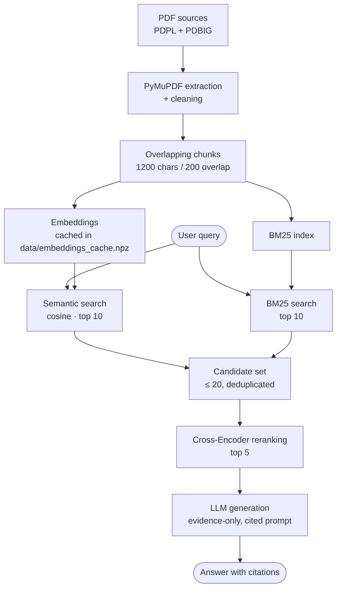

# DataLeak Retrieval Strategy Analyzer


[](https://ngrmbp5ix7svrfcsdgutdb.streamlit.app)

A Retrieval-Augmented Generation (RAG) pipeline that answers questions from two official Saudi documents, the Personal Data Protection Law (PDPL) and the Personal Data Breach Incidents Procedural Guide (PDBIG), with a focus on **retrieval quality**: semantic search and BM25 run side by side, their candidates are merged, reranked by a Cross-Encoder, and only the top evidence is handed to the LLM. The model is instructed to answer from that evidence alone.

Answers carry inline citations in the form `[PDPL · Article 6 · p. 4]`, and a Streamlit interface shows what each retrieval stage returned.

Built for *Modern Data Engineering for Advanced AI Systems* — SDAIA Academy.

## Try it online

The app is deployed on Streamlit Community Cloud: **https://ngrmbp5ix7svrfcsdgutdb.streamlit.app**

Ask one of the sample questions or type your own. No API key is needed; the sidebar lets you use your own OpenRouter key instead if you prefer. The first visit after a period of inactivity can take about a minute while the app wakes up.

## How it works



| Stage | Method | Model / library |
|---|---|---|
| PDF extraction | Page-by-page text, header/page-number cleanup | PyMuPDF |
| Chunking | Fixed-size character windows with overlap | — |
| Embeddings | Dense vectors via OpenRouter, cached locally | `liquid/lfm-2.5-embedding-350m:free` |
| Semantic search | Cosine similarity, top 10 | NumPy |
| Keyword search | BM25 over word tokens, top 10 | `rank-bm25` |
| Reranking | Cross-Encoder over (query, chunk) pairs, top 5 | `cross-encoder/ms-marco-MiniLM-L-6-v2` |
| Generation | Evidence-only prompt with mandatory citations, temperature 0 | `nvidia/nemotron-3-ultra-550b-a55b:free` |

Each chunk carries a citation tag built from its source, the article numbers it mentions and its page, e.g. `PDPL · Article 6 · p. 4` or `PDBIG · p. 5`. The tag heads every evidence block in the prompt, and the model is instructed to end each supported sentence with it.

The embedding cache is keyed by a hash of the chunk contents and the embedding model, so it is rebuilt automatically whenever the documents or the model change.

## Source documents

| Abbreviation | Document | Pages | Covers |
|---|---|---|---|
| **PDPL** | Personal Data Protection Law | 16 | Definitions, processing, disclosure, retention, security, violations, penalties |
| **PDBIG** | Personal Data Breach Incidents Procedural Guide | 8 | Notification, containment, affected data and individuals, risks, corrective actions |

PDPL is the abbreviation SDAIA itself uses for the law. PDBIG is this project's short name for the guide, used in citations because the full title is too long to repeat after every sentence.

Both PDFs are public documents published by SDAIA and are included under `data/raw/`.

## Quick start

```bash
git clone https://github.com/<your-username>/DataLeak_Retrieval_Strategy_Analyzer.git
cd DataLeak_Retrieval_Strategy_Analyzer

python -m venv .venv
# Windows
.venv\Scripts\activate
# macOS / Linux
source .venv/bin/activate

pip install -r requirements.txt
```

`requirements.txt` pins the CPU build of PyTorch, so the install stays around 1 GB instead of the multi-GB CUDA build. On the first run the Cross-Encoder (~90 MB) is downloaded from Hugging Face. The chunk embeddings for the included documents ship in `data/embeddings_cache.npz`; they are requested from OpenRouter again only if the documents or the embedding model change.

Add your [OpenRouter](https://openrouter.ai/) API key. Either create a `.env` file in the project folder containing:

```
OPENROUTER_API_KEY=your_key
```

or export it in the shell:

```powershell
# Windows PowerShell
$env:OPENROUTER_API_KEY = "your_key"
```

```bash
# macOS / Linux
export OPENROUTER_API_KEY="your_key"
```

`.env` is git-ignored, so the key never ends up in the repository.

## Usage

Web interface:

```bash
python -m streamlit run app.py
```

The app shows the answer with its citations, the evidence passages that were passed to the model, and three tabs with what semantic search, BM25 and the Cross-Encoder each ranked. Retrieval depths can be changed from the sidebar.

Interactive chat in the terminal:

```bash
python retrieval_debugger.py
```

Single question:

```bash
python retrieval_debugger.py -q "What is personal data according to Article 1?"
```

Add `--quiet` to hide the retrieval and reranking tables.

Example session:

```text
============================================================
DataLeak Retrieval Strategy Analyzer
============================================================

Reading PDFs...
PDPL (Personal Data Protection Law): 16 pages
PDBIG (Personal Data Breach Incidents Procedural Guide): 8 pages
Total chunks: 50

Loading embeddings...
Loaded embeddings from cache (50, 1024)

System ready. Ask questions about the provided documents. Type 'exit' to quit.
Citations: PDPL = Personal Data Protection Law, PDBIG = Personal Data Breach Incidents Procedural Guide.

------------------------------------------------------------
You: What is personal data according to Article 1?

Unique candidates for reranking: 17

============================================================
SEMANTIC SEARCH - TOP 10
============================================================
Rank 1 | Chunk 1 | PDPL · Article 1 · p. 2 | Score 0.6434 | Semantic
...

============================================================
BM25 SEARCH - TOP 10
============================================================
...

============================================================
CROSS-ENCODER RERANKING - TOP 5
============================================================
Rank 1 | Chunk 1 | PDPL · Article 1 · p. 2 | Score 6.9894 | Semantic
...

============================================================
GENERATING ANSWER...
============================================================

Assistant:
According to Article 1, Personal Data is any data, regardless of its source
or form, that may lead to identifying an individual specifically, or that may
directly or indirectly make it possible to identify an individual
[PDPL · Article 1 · p. 2].
```

## Deploying on Streamlit Community Cloud

1. Push the repository to GitHub.
2. On [share.streamlit.io](https://share.streamlit.io) choose *New app*, select the repository, branch `main` and `app.py`.
3. Under *Advanced settings → Secrets* add:
   ```toml
   OPENROUTER_API_KEY = "your_key"
   ```
4. Deploy. The first start takes a few minutes while PyTorch and the Cross-Encoder are downloaded; later restarts are faster.

The key stays in the app's secrets and is never committed. Both models used through OpenRouter are free-tier, but the key is still yours, so keep an eye on usage if the link is shared widely.

## Results

The eight test questions below were run end to end with the current code. Full retrieval tables and the model's answers are in [`docs/results.md`](docs/results.md).

| # | Query | Outcome |
|---|---|---|
| 1 | Definition of personal data (Art. 1) | Correct, cited `[PDPL · Article 1 · p. 2]` |
| 2 | Processing without consent (Art. 6) | Correct, four cases listed with citations |
| 3 | Definition of sensitive data | Correct but truncated at a chunk boundary; model did not fill the gap |
| 4 | When to notify SDAIA of a breach | Correct, 72-hour rule from PDBIG plus the duty from PDPL |
| 5 | Three stages of breach handling | Correct, cited across four PDBIG pages |
| 6 | Risks and consequences of a breach | Correct, cited |
| 7 | Penalty for violating the PDPL | Correct (Art. 35), and stated that other penalties are not in the text |
| 8 | *What is artificial intelligence?* (out of scope) | Declined; no outside knowledge used |

What stood out:

- Of the 40 chunks that reached the final top 5 across the eight runs, 22 were found by both retrievers, 12 by semantic search only and 6 by BM25 only, so neither retriever is redundant.
- The Cross-Encoder changed the order noticeably; the top semantic hit was not always the top reranked hit.
- For the out-of-scope query every reranker score was around −11 and the model refused to answer.
- Test 3 shows the cost of fixed-size chunking: a definition split across two chunks comes back incomplete.

## Project structure

```text
DataLeak_Retrieval_Strategy_Analyzer/
├── data/
│   ├── raw/
│   │   ├── PersonalDataProtectionLaw.pdf
│   │   └── PersonalDataBreachIncidents.pdf
│   └── embeddings_cache.npz
├── docs/
│   └── results.md
├── app.py                  # Streamlit interface
├── retrieval_debugger.py   # pipeline + CLI
├── requirements.txt
├── .gitignore
└── README.md
```

## Limitations

- Answers are limited to the two source documents.
- Chunking is character-based, so a definition can be split across chunks (seen in test 3).
- Cross-Encoder scores are relative ranking scores, not probabilities.
- Generation depends on the availability of the external model provider.
- This is a document-based RAG prototype, not a legal assistant.

## Future work

- Structure-aware chunking (by article / section)
- Metadata filtering by document and article
- Provider fallback for generation
- Comparison of alternative embedding and reranking models
